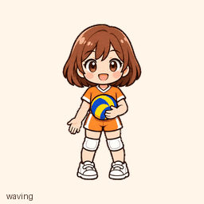

# 小晴 · 排球少女虚拟宠物

小晴是一位抱着排球的卡通少女。这个仓库提供她的透明动画素材，以及挥手、跳跃等动作的预览。



## 下载

在 GitHub 仓库页面选择 **Code → Download ZIP**，解压后即可查看文件；也可以单独打开 [透明动画素材](assets/spritesheet.png)，再使用 GitHub 的下载按钮保存原图。

- [查看全部动作](previews/all-states.gif)
- [查看跳跃动画](previews/jumping.gif)
- [查看全部帧和方向](docs/contact-sheet.png)
- [查看 16 个视线方向](docs/directions.png)

## 素材格式

`assets/spritesheet.png` 是透明 PNG，大小为 1536 × 2288 像素，按 8 列、11 行排列，每格 192 × 208 像素。表格中的行号从 0 开始；每行未使用的格子完全透明。

| 行 | 动作 | 帧数 |
| --- | --- | ---: |
| 0 | 待机 | 6 |
| 1 | 向右跑 | 8 |
| 2 | 向左跑 | 8 |
| 3 | 挥手 | 4 |
| 4 | 跳跃 | 5 |
| 5 | 失落 | 8 |
| 6 | 等待 | 6 |
| 7 | 专注工作 | 6 |
| 8 | 检查 | 6 |
| 9–10 | 视线方向 | 各 8 |

视线从正上方 0° 开始，按顺时针每 22.5° 排列，依次填充第 9 行和第 10 行。`previews/` 里的 GIF 可以直接观看；图片编辑器或支持精灵表的工具可以按上述尺寸切分 PNG。

这份素材按照 ChatGPT Work 宠物的 v2 动画表规格制作。下载文件本身不会自动安装宠物；能否导入以及具体操作取决于所使用产品提供的功能。

## 项目目录

```text
assets/spritesheet.png   透明动画素材
previews/                各动作与完整动画预览
docs/                    帧与视线方向总览
```

## 使用许可

本仓库的图片、动画素材和文档采用 [知识共享署名 4.0 国际许可协议（CC BY 4.0）](https://creativecommons.org/licenses/by/4.0/deed.zh-hans)。你可以复制、修改、再发布和商用，但需要适当署名、链接到该许可协议，并标明是否修改过作品。详见 [LICENSE](LICENSE)。

## 制作

小晴的角色视觉由 OpenAI 图像生成工具制作，动作素材经过帧数、透明背景和方向检查。
